# BIT 2118 Scientific Computing – Group Work Report

Tasks 2 to 20 (Task 1, the Data Science Essentials course, is self-paced and done separately on the course platform).

Every task has the same four parts, following the instructions in the brief:

1. **Inputs and the operation** the program performs
2. **What the output means** (and what the graph shows)
3. **A changed input** and how the result moved
4. **A new related case** with its assumptions, data, output and interpretation

Code is in `../code/`, graphs are in `../figures/`, and the raw text output of every run is in `../outputs/`. Each task has two scripts: `Task_XX_name.py` (the original program plus the changed-input experiment) and `Task_XX_name_extension.py` (the new case).

Libraries used: NumPy 2.4, SciPy 1.17, Matplotlib 3.10. Timings in Tasks 3 and 7 depend on the computer, so your numbers will differ a bit; the pattern should be the same.

---

## Task 2 – NumPy arrays and numerical computation

**Inputs and operation.** The input is one array of 24 hourly temperatures in °C. We take the mean, minimum and maximum, then apply F = 1.8C + 32 to the whole array in one line.

**Output.** Mean 23.12 °C, minimum 17.50 °C (early morning), maximum 29.40 °C (about midday). The first six Fahrenheit values run from 65.3 °F down to 63.5 °F and back up. So the day is a smooth warm-up and cool-down, which is what we expect from a weather station.

**Changed input.** We lowered every reading by 5 °C (a cloudy day). The mean fell by exactly 5 (23.12 to 18.12), min and max both fell by 5, and the range stayed at 11.9 °C. In Fahrenheit the mean dropped from 73.62 to 64.62, a drop of 9, which is 1.8 × 5. Shifting every value by a constant moves the mean, min and max by that constant but does not change the spread. The graph shows the two curves as identical shapes, one sitting lower.

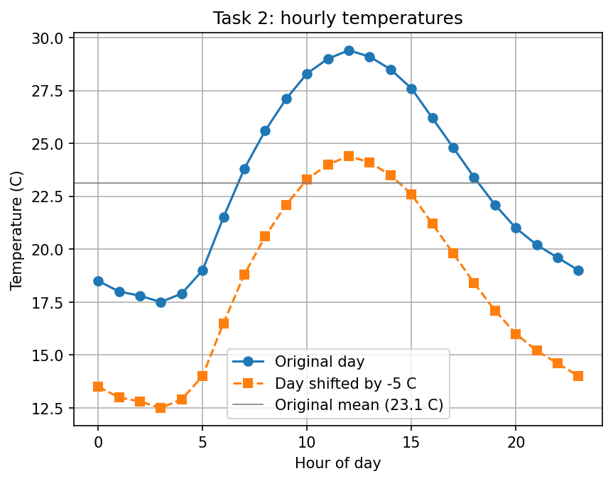

**New case – greenhouse soil moisture.** Six soil sensors report moisture (%) every 4 hours, stored as a 6×6 array (beds × times). Assumption: crops need at least 30 % moisture. Using `axis=1` and `axis=0` we get per-bed and per-time statistics at once.

- Mean per bed: 34.5, 37.83, 31.0, 41.0, 20.0, 33.0 %
- Beds that dipped below 30 %: 1, 3, 5 and 6
- Bed 5 fell from 40 % to 4 % in a day, a spread of 36 points while the others are 7–9. Either it's drying very fast or the sensor is faulty or drifting.

Interpretation: a small amount of NumPy is enough to flag sensors that need watering and one that needs checking. The overall mean across beds is lowest at midday (27.83 %), which suggests watering should happen before noon.

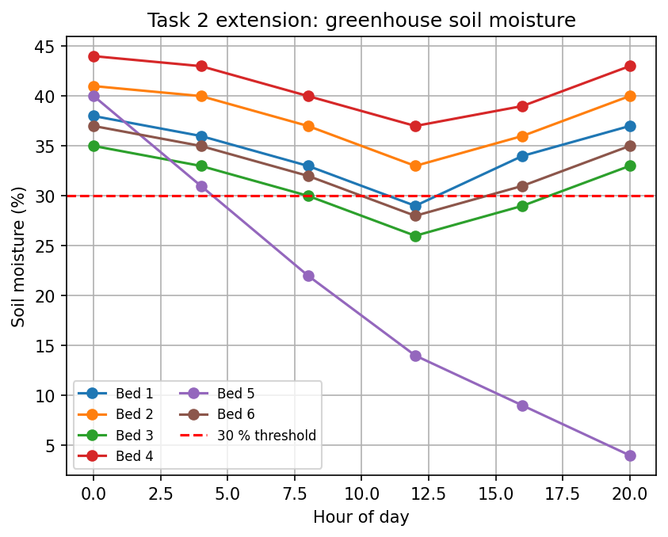

---

## Task 3 – Mathematical functions and vectorization

**Inputs and operation.** One million simulated latency values between 5 and 250 ms. Each is converted to seconds and squared, first with a Python `for` loop and then with `latency/1000` and `**2` on the whole array.

**Output.** Loop 0.1726 s, vectorized 0.0033 s, about 52 times faster. Both give the same numbers (first one 0.0379 s²). The speed difference comes from NumPy doing the loop in compiled code instead of Python.

**Changed input.** We varied the number of measurements from 1,000 to 1,000,000. The speed-up was 63x, 134x, 132x and 100x. So vectorization wins at every size, by roughly 60 to 130 times. The exact ratio wobbles from size to size (overheads and memory caching), and the log-log graph shows both curves rising in parallel with the vectorized one far below.

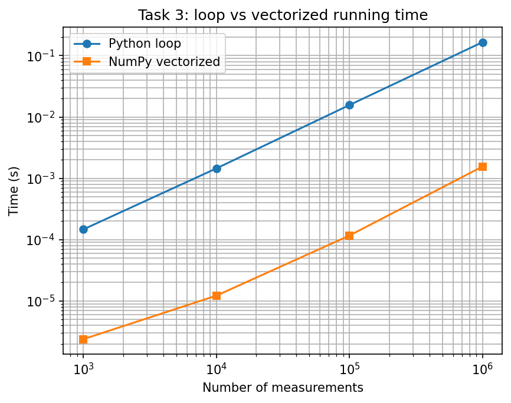

**New case – audio clipping.** 5 seconds of a 440 Hz tone at 44.1 kHz (220,500 samples) plus a little noise. We amplify by 3 and clip to ±1 like an overdriven speaker. Assumption: the tone has amplitude 0.4.

- RMS before: 0.2835, after gain: 0.8505, after clipping: 0.7823
- 36.8 % of samples were clipped
- Loop version 0.0947 s vs `np.clip` 0.0016 s (59x)

Interpretation: clipping lowers the RMS compared with the unclipped amplified signal because the peaks are flattened, and it distorts the wave shape (see the flat tops in the graph). Real audio has millions of samples so the vectorized form is the only practical choice.

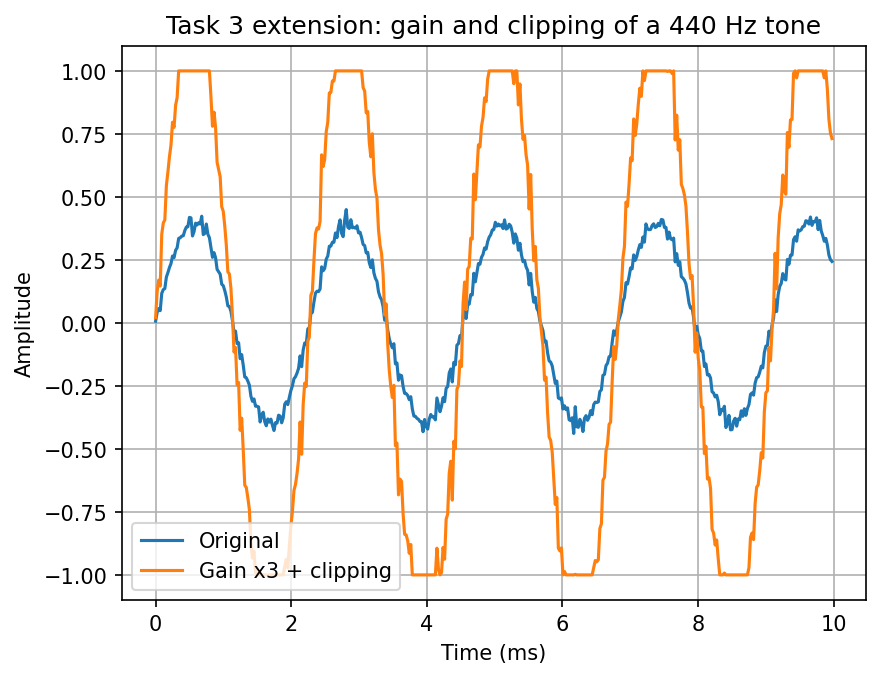

---

## Task 4 – Floating-point arithmetic and numerical errors

**Inputs and operation.** Three small experiments: compare 0.1 + 0.2 with 0.3; measure absolute and relative error when √2 is replaced with 1.414; and compare two algebraically equal formulas for (√(1+x) − 1)/x.

**Output.**
- `0.1 + 0.2` is `0.30000000000000004`, so `==` gives False but `np.isclose` gives True. Decimal 0.1 has no exact binary form.
- Absolute error 0.00021356, relative error 0.0151 %.
- For the formula: at x = 1e-4 both versions agree; at 1e-8 the direct one is already wrong in the 9th digit (0.499999996961 vs 0.499999998750); at 1e-12 it gives 0.500044 against the correct 0.500000. This is cancellation: √(1+x) is very close to 1, so subtracting 1 wipes out most of the significant digits.

**Changed input.** Better approximations of √2 give smaller errors in proportion: 1.4 gives a relative error about 1e-2, 1.41421 about 2.5e-6, 1.4142136 about 2.7e-8. We also pushed x to 1e-16 and the direct formula returned exactly 0.0 while the true answer is 0.5. Since 1 + 1e-16 rounds to 1, all information is lost. The graph shows relative error growing as x shrinks.

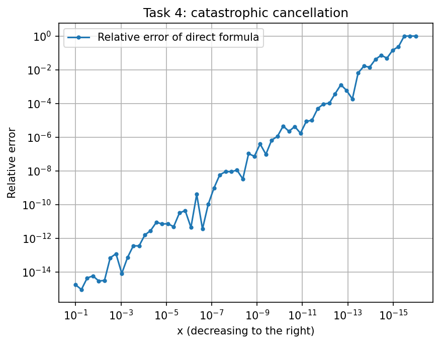

**New case – money.** A shop adds up 10,000 payments of 0.10 KES. Assumption: the correct total is 1,000.00.

- Naive float loop: 1000.0000000001588 (error 1.6e-10)
- `math.fsum`: 1000.0, `Decimal`: 1000.00, `np.sum`: 999.9999999999999
- Compounding 5,000,000 at 7 % for 30 years: float64 gives 38,061,275.21 and float32 gives 38,061,336.00, a difference of about 61 KES.

Interpretation: the errors are tiny per step but they accumulate, and `==` checks on money totals will fail. For real accounting use `Decimal` or integer cents, and never use float32 for financial sums.

---

## Task 5 – Matrix algebra and matrix operations

**Inputs and operation.** Four corners of a unit square, a 45° rotation matrix and a scaling matrix (2 in x, 1.5 in y). They are multiplied into one transformation matrix `T = R @ S` and applied to every point.

**Output.** The transformed corners are (0,0), (1.414, 1.414), (0.354, 2.475) and (−1.061, 1.061). The determinant is 3.0, which equals 2 × 1.5, the area scale factor. Rotation alone doesn't change area, so only the scaling counts. The square becomes a tilted rectangle three times the area.

**Changed input.** With a 90° rotation and scale (1, 3) the points become (0,0), (0,1), (−3,1), (−3,0): a tall thin rectangle turned onto its side. The determinant is again 3. A reflection about the x-axis has determinant −1, so a negative determinant tells us orientation is flipped.

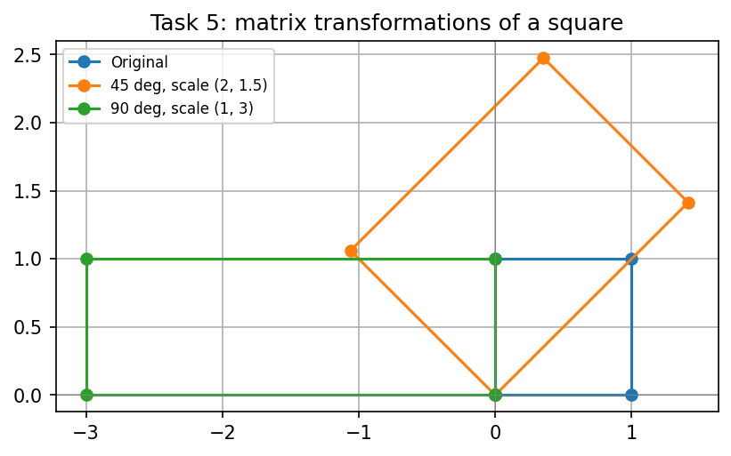

**New case – two-link robot arm.** Links of 0.5 m and 0.3 m. The tip is found by chaining rotation matrices: elbow = R(θ1)·[L1, 0], tip = elbow + R(θ1+θ2)·[L2, 0]. Assumption: rigid links, base at the origin.

| θ1, θ2 | Tip (m) | Reach (m) |
|---|---|---|
| 30°, 45° | (0.511, 0.540) | 0.743 |
| 60°, −30° | (0.510, 0.583) | 0.774 |
| 90°, 90° | (−0.300, 0.500) | 0.583 |
| 0°, 0° | (0.800, 0.000) | 0.800 |

Interpretation: the fully stretched arm reaches 0.8 m (= L1 + L2) and no pose can exceed that. Any bend shortens the reach.

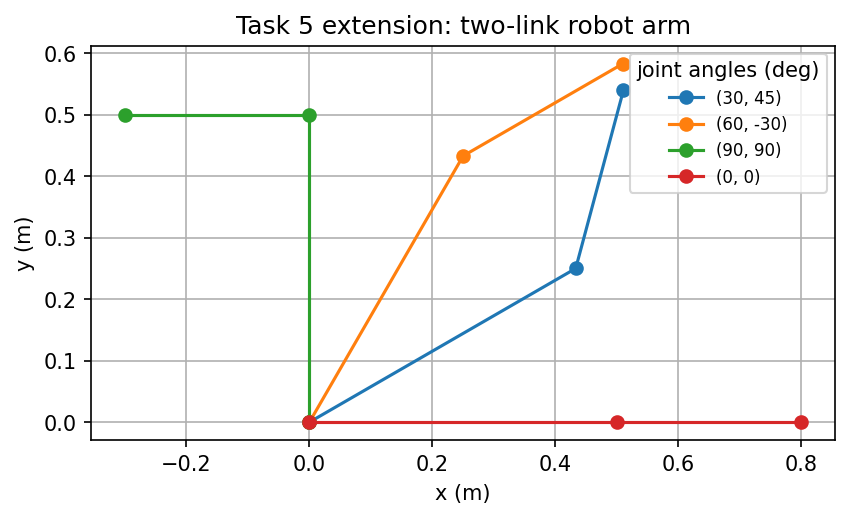

---

## Task 6 – Solution of systems of linear equations

**Inputs and operation.** CPU: 4x + 2y = 20 and memory: 8x + 12y = 72, where x and y are counts of Type A and Type B servers. `np.linalg.solve(A, b)` finds the point where both are true.

**Output.** x = 3 and y = 4. The residual is exactly zero, so the solution reproduces the observed usage. Graphically the two lines cross at (3, 4).

**Changed input.** Memory total changed from 72 to 80 GB gives x = 2.5, y = 5. Half a server can't exist, so this tells us the new totals are not consistent with whole servers; the data or the assumptions need checking. We also tried a nearly singular matrix (Type B almost identical to Type A). Its condition number is about 250,002 compared with 6.98 for the original. With b = [20, 40] the solution is [5, 0], but changing b by just 0.01 to [20, 40.01] gives [−45, 100]. So when the rows are nearly parallel, tiny measurement errors produce huge changes in the answer.

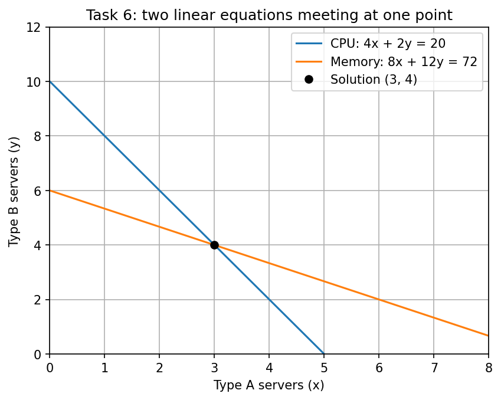

**New case – balancing chemical equations.** For a C₃H₈ + b O₂ → c CO₂ + d H₂O we write atom balances for C, H and O and fix a = 1. The solver gives C₃H₈ + 5 O₂ → 3 CO₂ + 4 H₂O with zero residual. Applying the same idea to iron gives 4 Fe + 3 O₂ → 2 Fe₂O₃.

Interpretation: balanced equations are only defined up to a scale factor, so one coefficient has to be fixed before the system has a unique answer.

---

## Task 7 – Gaussian elimination and LU decomposition

**Inputs and operation.** A fixed 3×3 matrix A and three different measurement vectors. `lu_factor` does the elimination once; `lu_solve` then solves for each vector cheaply.

**Output.** Solutions: [5, 5, 5], [5.317, 5.268, 4.756] and [4.902, 5.610, 5.537]. Residual norms are at the 1e-15 level, so they are exact to machine precision. The L factor has multipliers −0.25 and −0.2667 below the diagonal and the U diagonal is 4, 3.75, 2.7333 (the pivots). All pivots are well away from zero so no trouble.

**Changed input.** Setting A[2,2] from 3 to 1 changes the solution for the first vector from [5, 5, 5] to [5.91, 8.64, 18.64], so the weaker diagonal makes the system very sensitive. We also timed 200 right-hand sides on a 600×600 matrix: calling `solve` every time took 1.10 s, factoring once and reusing took 0.035 s (about 31x faster).

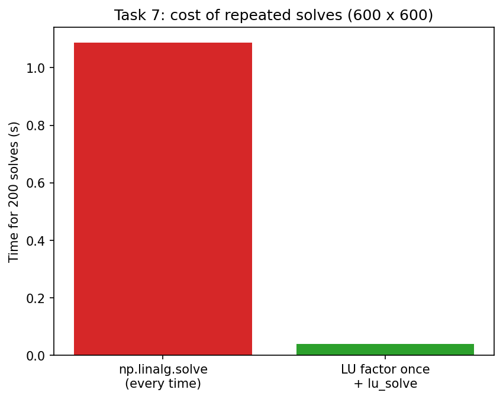

**New case – temperature of a heated rod.** 8 interior segments, ends held at 0 °C, tridiagonal matrix (2 on the diagonal, −1 beside it). The matrix never changes but the heat source does, so we factor once and run four scenarios.

| Scenario | Peak | Where |
|---|---|---|
| Heater in the middle | 40.00 | segment 4 |
| Heater at left end | 8.89 | segment 1 |
| Even heating | 30.00 | segment 4 |
| Two heaters | 16.00 | segment 2 |

Interpretation: the same heat input gives a much higher peak in the middle than near a cold end, because the cold ends carry heat away. Units are arbitrary.

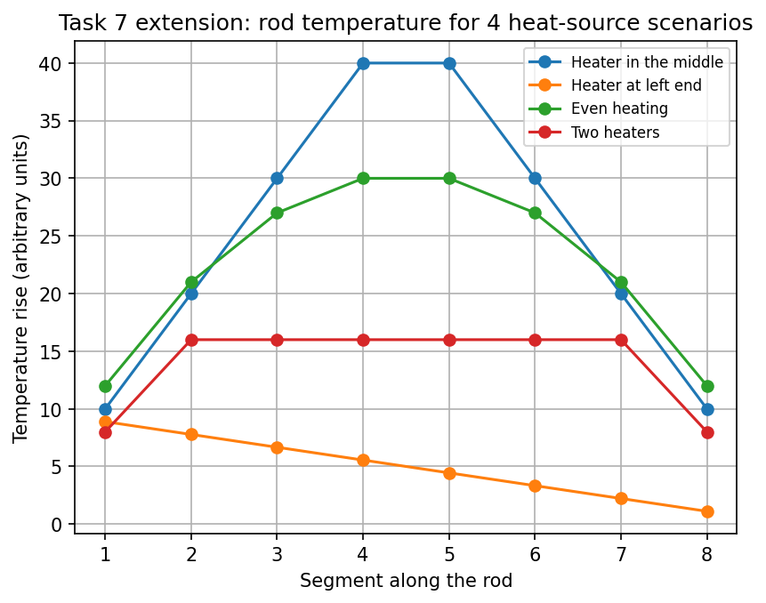

---

## Task 8 – Iterative methods for linear systems

**Inputs and operation.** A 5-point temperature model with 2 on the diagonal and −1 beside it. Boundaries are 100 °C on the left and 20 °C on the right. Jacobi uses only old values in each sweep; Gauss-Seidel uses new values as soon as they are computed. Stopping when the largest change is below 1e-8.

**Output.** Jacobi needed 150 iterations and Gauss-Seidel 75. Both reach [86.67, 73.33, 60.0, 46.67, 33.33], which matches the direct solution. The temperatures fall linearly from the hot end to the cold end, as heat conduction in a uniform bar should. The convergence graph shows both errors dropping in straight lines on a log scale, with Gauss-Seidel twice as steep.

**Changed input.** A tighter tolerance costs more iterations: 1e-4 needs 86 vs 43, 1e-12 needs 214 vs 107. The ratio stays about 2 to 1. Raising the left boundary to 200 °C gave [170, 140, 110, 80, 50], still linear. For a matrix that is not diagonally dominant ([[1,3],[4,1]]) Jacobi blew up to values near 1e16 instead of reaching the true answer [1.18, 1.27], so the convergence condition really matters.

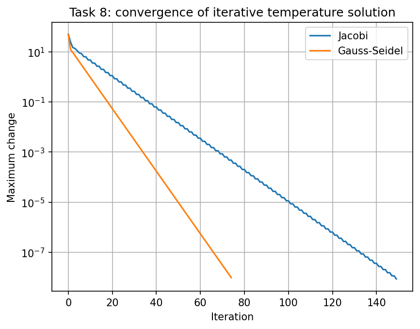

**New case – 2-D heated plate.** A 20×20 grid, top edge 100 °C, the other three edges 0 °C, each interior point is the average of its four neighbours. That's 324 unknowns. Gauss-Seidel converged in 504 sweeps. The cell near the middle (row 10, column 10) is 22.81 °C and the cell just below the hot edge is 89.36 °C.

Interpretation: heat dies out quickly away from the hot edge. For a square plate with one edge at 100 and three at 0, theory says the exact centre is 25 °C, the average of the four edges. Our 22.81 is a bit lower because a 20-point grid has no cell exactly in the middle and index 10 sits slightly on the cold side. Iteration is natural here because the matrix is mostly zeros.

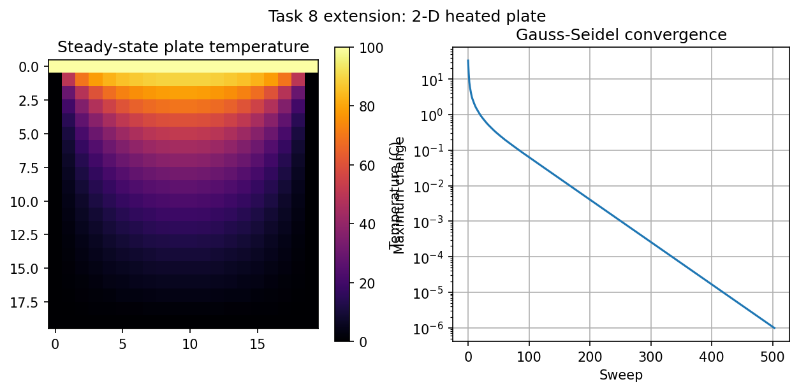

---

## Task 9 – Eigenvalues and eigenvectors

**Inputs and operation.** Adjacency matrix of a 4-node network (A–B, A–C, B–C, B–D, C–D). `np.linalg.eig` gives the eigenvalues; the eigenvector for the largest one, normalized to sum to 1, is a score of how influential each node is.

**Output.** The dominant eigenvalue is 2.5616. Scores: A = 0.2192, B = 0.2808, C = 0.2808, D = 0.2192. B and C connect to three nodes each so they score higher than A and D. The check ‖Av − λv‖ is about 2e-15, confirming the pair is correct.

**Changed input.** Adding an A–D link makes every node connect to every other (complete graph). The dominant eigenvalue rises to 3 and all scores become 0.25. Removing the B–C link instead turns the network into a ring where every node has two links; the eigenvalue falls to 2 and again all scores are 0.25. So the more connected the network, the larger the dominant eigenvalue, and equal connectivity gives equal importance.

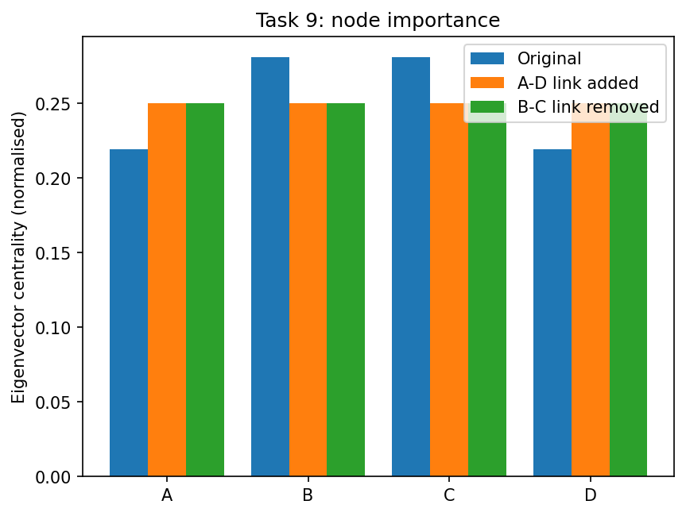

**New case – PCA of student marks.** Marks of 8 students in Maths, Physics and Programming. After centring the data we take the eigenvalues of the covariance matrix.

- Eigenvalues 920.38, 34.02, 3.21, so the first component explains 96.1 % of the variance.
- Its loadings are almost equal (0.603, 0.585, 0.542).

Interpretation: students who do well in one subject do well in all three, so one "overall ability" number almost replaces the three marks. The second component explains only 3.6 %. Assumption: marks are linearly related and the sample is small, so it's an illustration and not a research result.

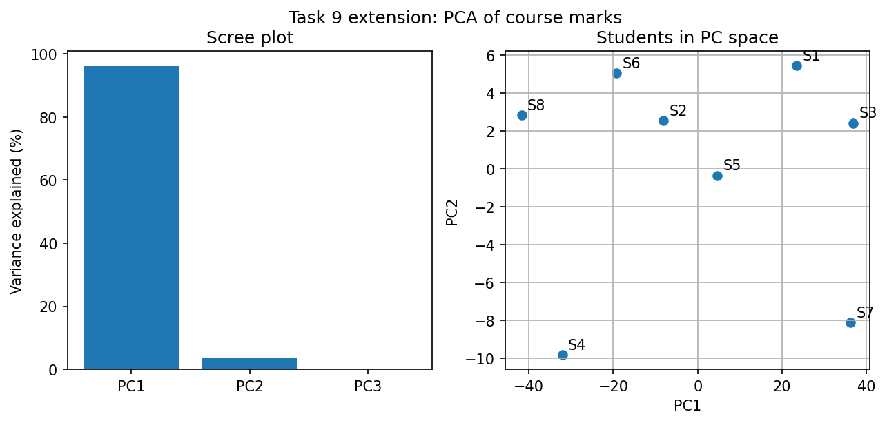

---

## Task 10 – Root finding: bisection and fixed point

**Inputs and operation.** Heat-balance function f(T) = T − 25 − 10·e^(−T/20). Bisection starts from [20, 40] where f changes sign. Fixed-point iteration uses T = 25 + 10·e^(−T/20) from T₀ = 30.

**Output.** Both reach 27.525211 °C. Bisection took 38 halvings for tolerance 1e-10; fixed point took 13 iterations. So the equilibrium temperature is about 27.5 °C, slightly above the 25 °C ambient because of the extra 10 °C heat term, reduced by the exponential. On the graph the curve crosses zero at that point.

**Changed input.** With the gain increased from 10 to 30 the equilibrium moves up to 31.279 °C and fixed point needs 22 iterations (slower, since the slope of g is bigger). The number of bisection steps depends on tolerance only: 11 for 1e-2, 18 for 1e-4, 31 for 1e-8 and 45 for 1e-12, which is about 3.3 extra steps per extra digit.

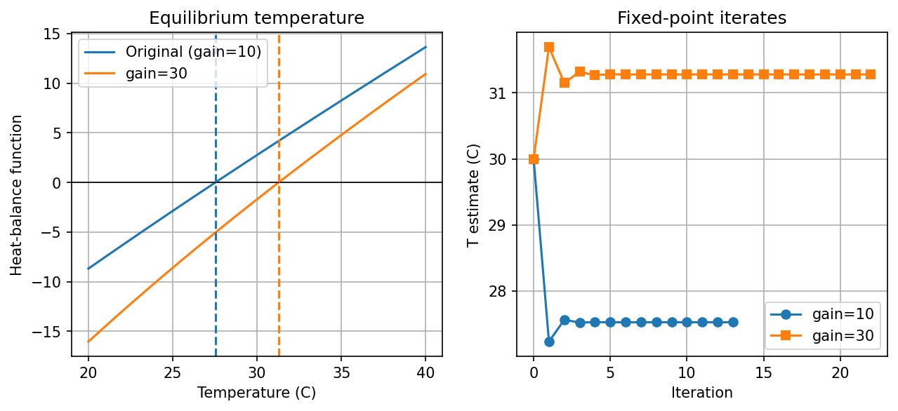

**New case – bakery break-even.** Price 60 KES per loaf, fixed costs 45,000 KES per month, variable cost per loaf 35 − 0.002q (bulk discount). Assumption: everything made is sold. Bisection on profit(q) finds the break-even at 1,596.18 loaves per month (33 iterations). If the price drops to 55 KES it rises to 1,892.02 loaves.

Interpretation: a 5 KES price cut (8 %) pushes the break-even up by about 296 loaves (19 %), so the business is quite sensitive to price.

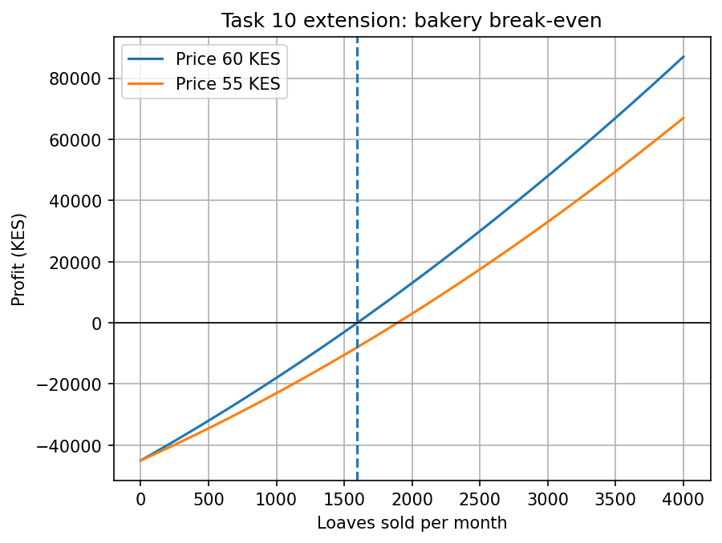

---

## Task 11 – Root finding: Newton-Raphson and secant

**Inputs and operation.** Cash flows −10,000, then 3,000, 3,500, 4,000, 2,500 over four years. The internal rate of return (IRR) is the rate that makes the net present value zero. Newton uses the derivative of NPV; the secant method only uses function values.

**Output.** IRR = 11.542461 % from both. Newton took 4 iterations and secant 7. NPV at the answer is 0. Interpretation: the project earns about 11.5 % a year, so it is worth doing if the cost of capital is below that.

**Changed input.** Different Newton starting points: 0.01 took 5 iterations, 0.10 took 4, 0.50 took 8, and 1.0 converged to −154 %, which is a different, meaningless root of the polynomial. So the starting guess matters. With weaker inflows (2,000, 2,500, 3,000, 2,000, total 9,500 < 10,000) the IRR becomes −2.0 %: the project loses money. The error table shows Newton gaining many digits per step (1.5e-2, 4e-4, 2.8e-7, 1.3e-13), the secant being a bit slower and bisection halving the error roughly.

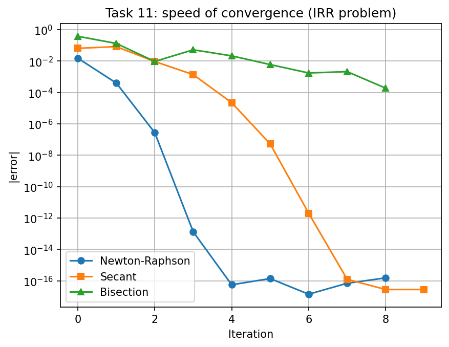

**New case – implied loan interest.** A motorbike costs 150,000 KES; the dealer asks 36 monthly payments of 5,200 KES. Solving for the rate gives 1.250228 % per month (secant 6 iterations, Newton 4). That is 15.00 % a year nominal and 16.08 % effective. Total repaid is 187,200 KES, i.e. 37,200 KES of interest.

Interpretation: the dealer's "15 %" is the nominal rate; compounding makes the real yearly cost about 16 %.

---

## Task 12 – Polynomial and nonlinear equations

**Inputs and operation.** Circle x² + y² = 4 and parabola y = x² − 1 as two residual equations, solved with `scipy.optimize.root` from two guesses.

**Output.** The intersections are (1.5175, 1.3028) and (−1.5175, 1.3028), residuals about 1e-13. Substituting x² = y + 1 gives y² + y − 3 = 0 with roots 1.3028 and −2.3028; the second gives x² negative so it has no real point. That's why only two intersections exist.

**Changed input.** With radius 1 there are three intersections, (±1, 0) and (0, −1); different starting guesses found different ones, and the guess (3, 3) still ended on (1, 0). With the parabola lowered to y = x² − 5 the solver reports no convergence, which is correct because the curves don't meet. A solver failing to converge can mean there's simply no real solution.

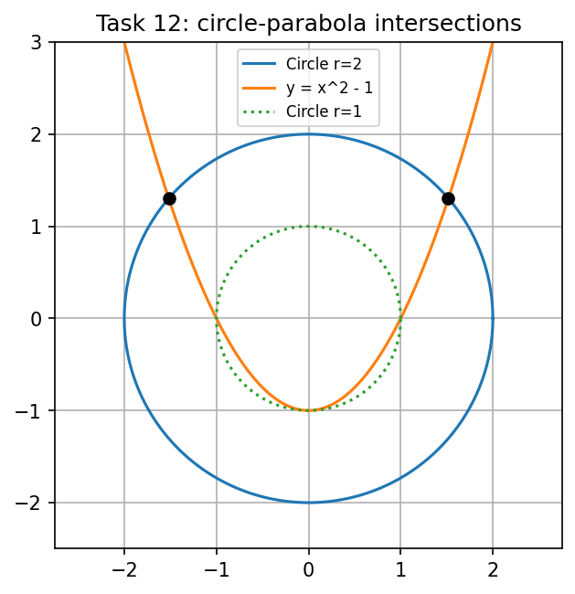

**New case – ball thrown at a hill.** Launch speed 20 m/s at 50°, hillside y = 0.3x, g = 9.81, no air resistance. Three unknowns (t, x, y). The ball lands after 2.337 s at x = 30.05 m, y = 9.01 m. The closed-form check t = (v sin a − 0.3 v cos a)/(g/2) gives the same 2.337 s. A steeper hill (slope 0.6) shortens the flight to 1.551 s and lands at x = 19.94 m, y = 11.96 m.

Interpretation: a steeper slope catches the ball earlier and nearer, but higher up.

---

## Task 13 – Interpolation

**Inputs and operation.** Hourly temperatures from 08:00 to 14:00. We build a linear interpolant and a cubic spline and evaluate them every 10 minutes.

**Output.** At 10:30 linear gives 23.25 °C and the cubic spline 23.36 °C; the biggest difference anywhere is 0.19 °C. The linear curve is made of straight pieces with corners, the spline is smooth.

**Changed input.** (a) We hid the 12:00 reading (true 25.0 °C) and estimated it: linear 24.75 (error 0.25), cubic 25.03 (error 0.03). The spline does better on smooth data. (b) We put a fake sensor spike of 30 °C at 11:00. The spline then overshoots and wiggles, e.g. 27.01 °C at 10:30 and dipping to 24.29 °C between 12 and 13, below both neighbouring readings, while linear stays within the data. So splines look nicer but can produce oscillations near sudden jumps. (c) Extrapolating to 15:00 gave 22.94 °C; it is outside the data so it shouldn't be trusted.

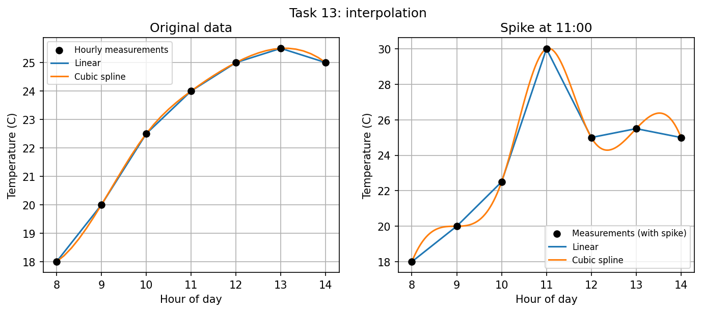

**New case – river gauge gap.** Water level every 6 hours for 3 days; two readings are lost in a power cut. Assumption: the level changes smoothly. At t = 24 h the true value is 2.048 m and both methods recover it. At t = 54 h the true value is 2.674 m; the spline gives 2.659 m (error 0.015) and linear 2.508 m (error 0.166).

Interpretation: where the curve bends, a spline fills the gap much better. Neither would be reliable if a flash flood happened inside the gap.

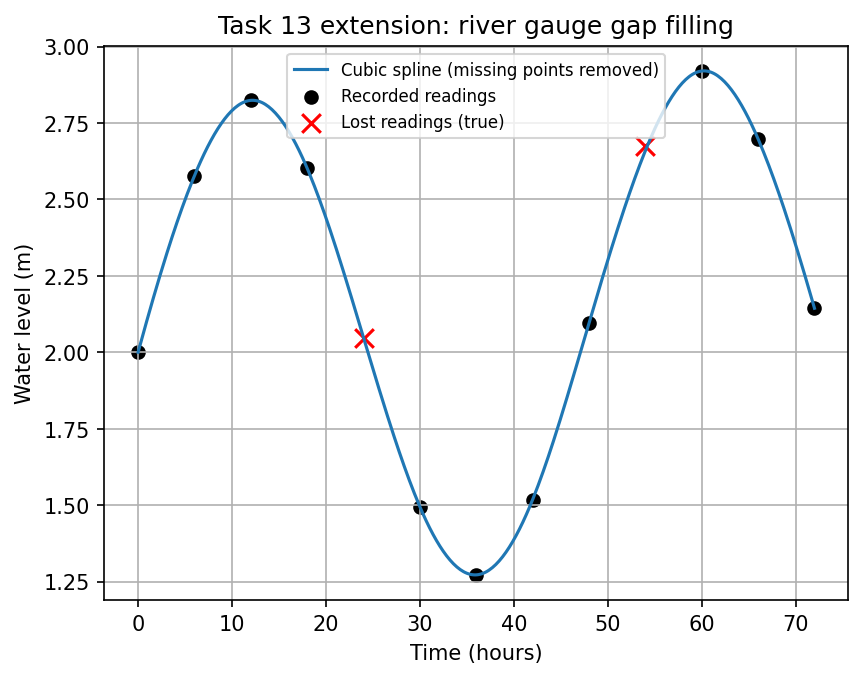

---

## Task 14 – Curve fitting and approximation

**Inputs and operation.** Response time (ms) against concurrent users for 50 to 350 users. We fit y = ax² + bx + c with `curve_fit` (least squares).

**Output.** y = 0.002167x² − 0.1345x + 85.00 with RMSE 1.55 ms, so the curve passes within about 1.5 ms of each point. Prediction at 400 users: 377.9 ms. The response time accelerates as users increase, a typical sign of a system nearing capacity.

**Changed input.** An exponential model gave a similar RMSE (1.43 ms) but predicts 400.4 ms at 400 users, so two models that fit equally well disagree once we go beyond the data. A straight line fits badly (RMSE 18.8 ms) and predicts only 312.9 ms. Changing one measurement (200 users → 220 ms, an outlier) moved the 400-user prediction from 377.9 to 345.7 ms. The residual plot makes the straight line's systematic curve-shaped error obvious.

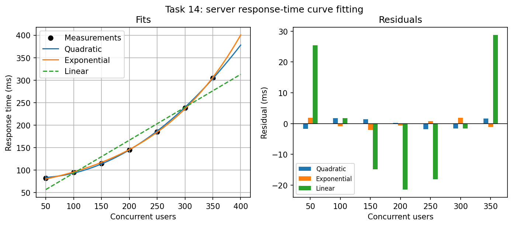

**New case – logistic growth of app subscribers.** Monthly subscribers in thousands over 12 months, growth slowing near saturation. Model N = K/(1 + e^(−r(t − t₀))). Fit: K = 294.4 thousand, r = 0.568 per month, midpoint at month 6.7, RMSE 0.70 thousand. The forecast for month 18 is 293.9 thousand. A straight line would forecast 467 thousand, which is more than the market limit.

Interpretation: a model has to match the physics of the situation; the logistic curve has a built-in ceiling, the line doesn't.

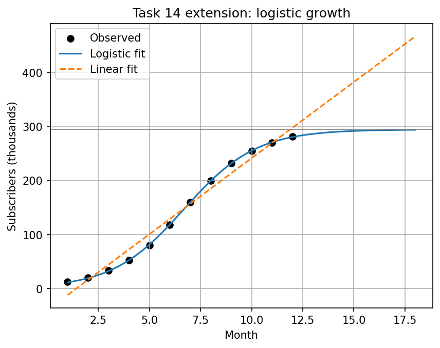

---

## Task 15 – Numerical differentiation

**Inputs and operation.** GPS positions each second for 6 seconds. Speed is estimated with a forward difference at the start, central differences inside and a backward difference at the end.

**Output.** Speed rises from 4.80 m/s at t = 0 to 8.00 m/s at t = 6, passing 6.25 m/s at 3 s. The vehicle is speeding up by roughly 0.5 to 0.7 m/s every second. `np.gradient` gives identical values.

**Changed input.** On x(t) = t³ (true derivative at t = 2 is 12) we varied the step h. The central difference is far more accurate: at h = 0.01 the forward error is 6e-2 but the central error is 1e-4. Making h too small hurts: at h = 1e-14 both errors jump back to 0.1–0.26 because of round-off. So there's a best h in the middle. Adding 0.3 m of GPS noise changed estimated speeds by up to 1.38 m/s, because differentiating amplifies noise.

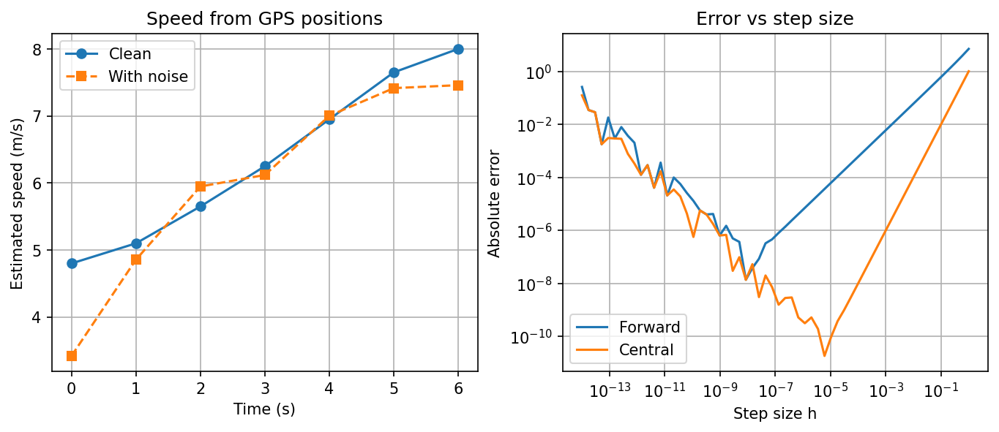

**New case – elevator acceleration.** Velocity every 0.5 s during a ride. Acceleration from `np.gradient`. The peak is +1.4 m/s² at the start and −1.4 m/s² at the stop; values above 1.0 m/s² were flagged as uncomfortable (1.0–2.0 s and 8.0–9.0 s). The distance travelled from integrating velocity is 20.5 m.

Interpretation: the start and stop are the harsh parts of the ride; smoother velocity ramps would stay under the limit.

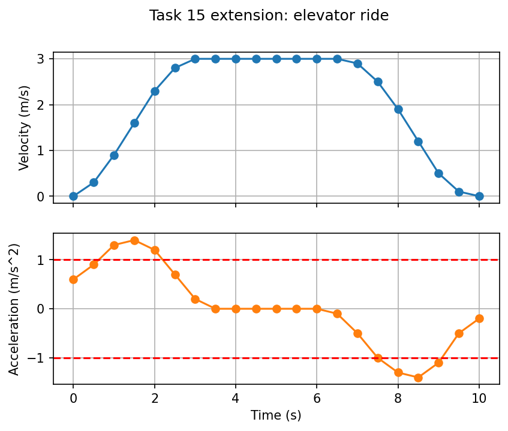

---

## Task 16 – Numerical integration

**Inputs and operation.** Smart-meter power (kW) every two hours for 12 hours. The area under the power curve is energy in kWh, computed with the trapezoidal rule and Simpson's rule.

**Output.** Trapezoid 15.700 kWh, Simpson 15.800 kWh, a difference of 0.100 kWh (0.6 %). The area under the curve is the total energy used over the 12 hours.

**Changed input.** (a) Using hourly values from a spline gave 15.735 and 15.746 kWh against a reference of 15.746, so finer sampling makes the two rules agree. (b) On sin(x) from 0 to π (true value 2), Simpson's error shrinks much faster than the trapezoid's: with 17 points trapezoid error is 6.4e-3 and Simpson 1.7e-5. (c) A 3.5 kW spike at 06:00 gave 19.10 kWh (trapezoid) vs 20.33 kWh (Simpson), so with a sharp spike and sparse sampling the rules disagree a lot and the number isn't trustworthy.

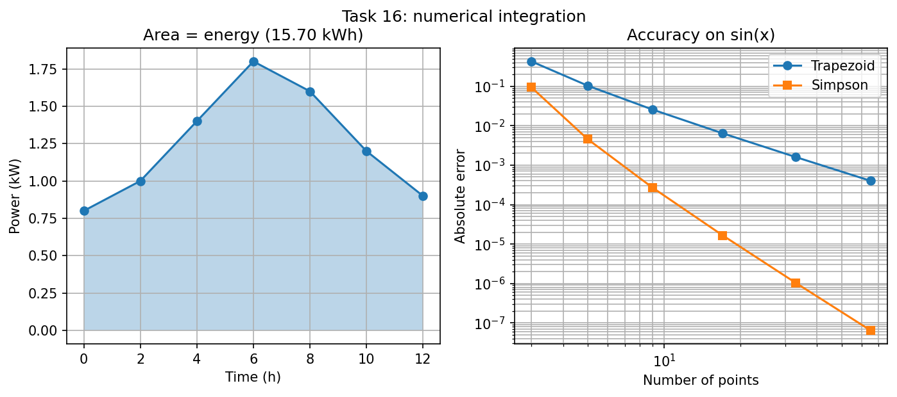

**New case – borehole water volume.** Flow rate (L/min) every 15 minutes for 3 hours. Volume = 5,715 L (trapezoid) or 5,770 L (Simpson), average flow 31.8 L/min. A 5,000 L tank would already be passed by the 150-minute reading (5,055 L cumulative, against 4,582 L at 135 minutes).

Interpretation: the answer is a total from rate data, and the two rules agree within 1 %.

---

## Task 17 – ODEs: Euler's method

**Inputs and operation.** Newton's cooling law dT/dt = −k(T − 25), T₀ = 90 °C, k = 0.12 per minute, step h = 1 min, 30 minutes. Each step is T_new = T + h·(−k(T − 25)).

**Output.** Euler gives 26.40 °C after 30 minutes, the exact solution gives 26.78 °C, error 0.372 °C. The object cools quickly at first and slowly later as it approaches the room temperature of 25 °C.

**Changed input.** Smaller steps give smaller errors, about proportional to h: h = 5 → 1.51 °C, h = 2 → 0.72, h = 1 → 0.37, h = 0.5 → 0.19, h = 0.1 → 0.038. We also tried a faster cooling constant, k = 0.3. At h = 5 (k·h = 1.5) the answer oscillates below the ambient (as low as −7.5 °C, which is physically impossible) and at h = 7 (k·h = 2.1) it blows up to −79 °C. So Euler needs k·h < 2 to stay stable, and in practice much smaller to be accurate.

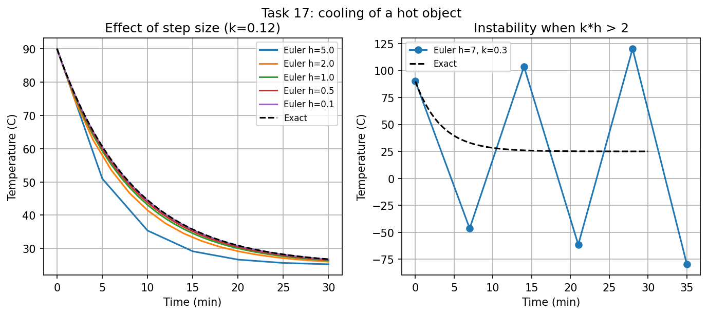

**New case – SIR epidemic in a school.** 1,000 pupils, 1 infected at the start, recovery rate 0.1 per day and contact rate β. Euler with h = 0.5 day, 120 days. Assumptions: closed population, no re-infection.

| β | R₀ | Peak infected | Day of peak | Total ever infected |
|---|---|---|---|---|
| 0.40 | 4.0 | 414 | 28 | 982 |
| 0.20 | 2.0 | 156 | 69 | 768 |
| 0.12 | 1.2 | 8 | 120 (end of run) | 44 |

Interpretation: halving the contact rate cuts the peak by almost two thirds and delays it by six weeks. The β = 0.12 run was still growing slowly when the 120 days ended, so its numbers would be larger with a longer simulation.

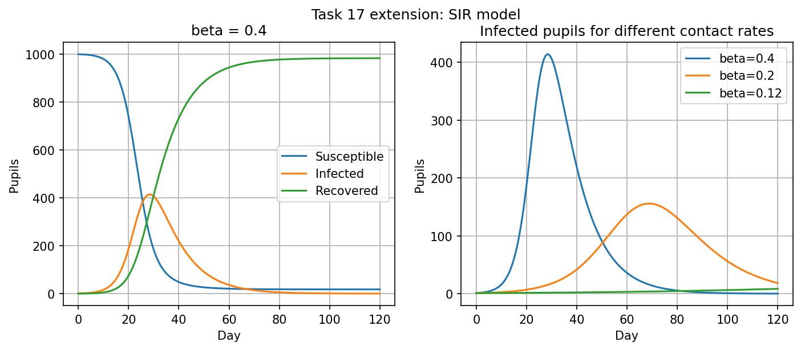

---

## Task 18 – ODEs with SciPy

**Inputs and operation.** RC charging circuit dV/dt = (Vs − V)/(RC) with Vs = 5 V, R = 1000 Ω, C = 1 mF (time constant 1 s), starting at 0 V, solved over 5 s with `solve_ivp` and tight tolerances.

**Output.** V(5 s) = 4.9663 V, very close to the 5 V supply. The maximum difference from the exact formula is 9.3e-10 V, so the solver is extremely accurate. The graph is the usual rising curve flattening toward 5 V.

**Changed input.** Capacitance 0.5, 1 and 2 mF gives time constants 0.5, 1 and 2 s. The time to reach 63.2 % of 5 V matched those values (0.503, 1.005, 2.010 s). V(5 s) is 4.9998, 4.9663 and 4.5896 V respectively, so a bigger capacitor charges more slowly. Discharging from 5 V gives 1.83 V after about 1 s (5·e⁻¹ ≈ 1.84). With a looser tolerance (1e-3) the solver used 56 function calls rather than 386 and the error was still only 6.6e-4 V.

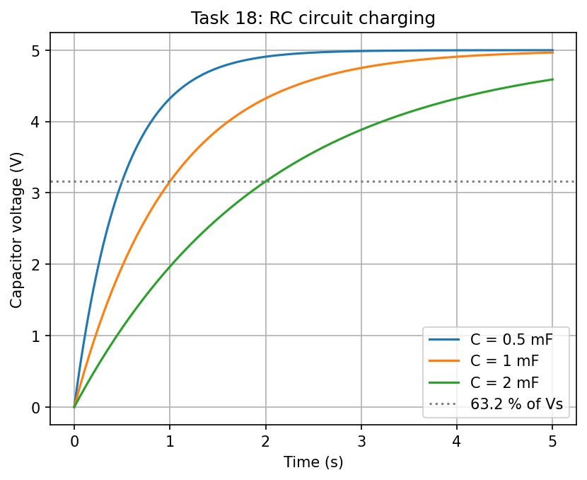

**New case – predator–prey (Lotka–Volterra).** Gazelles x and cheetahs y in hundreds: dx/dt = 0.8x − 0.4xy and dy/dt = −0.6y + 0.3xy, starting at (3, 1). Assumptions: unlimited prey food, no other predators, no migration. The populations cycle: prey between 0.75 and 4.18 and predators between 0.88 and 3.82 (hundreds), with the equilibrium at (2, 2). A conserved quantity of the model drifted only 3e-9, a good check on the solver.

Interpretation: predators peak after prey, then crash when prey runs low, which lets prey recover. The phase portrait is a closed loop around the equilibrium.

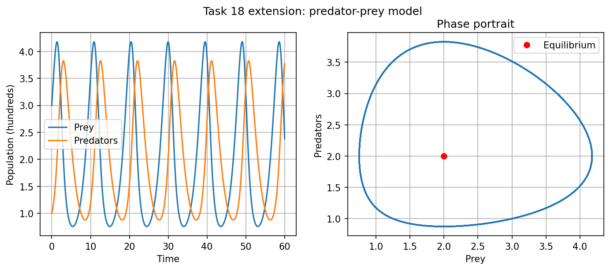

---

## Task 19 – Numerical optimization

**Inputs and operation.** Minimise cost 12x + 18y subject to capacity 100x + 170y ≥ 1000 and x, y ≥ 0, using SLSQP. Then check whole-number combinations.

**Output.** The optimum is x = 0, y = 5.882 with cost 105.88 and capacity exactly 1000. Type B is cheaper per unit of capacity (18/170 = 0.106 vs 12/100 = 0.120), so only Type B is used. With whole servers the best is 6 Type B for 108.00 (capacity 1020).

**Changed input.** Required capacity 1500 gives y = 8.824 (158.82), or 9 servers for 162 as integers. If Type B's cost rises to 30 its cost per capacity becomes 0.176 and the optimum switches completely to Type A (x = 10, cost 120). Three different starting guesses all ended at the same answer, which makes sense for a linear problem with one optimum. The graph shows the cost lines sliding to the corner of the feasible region.

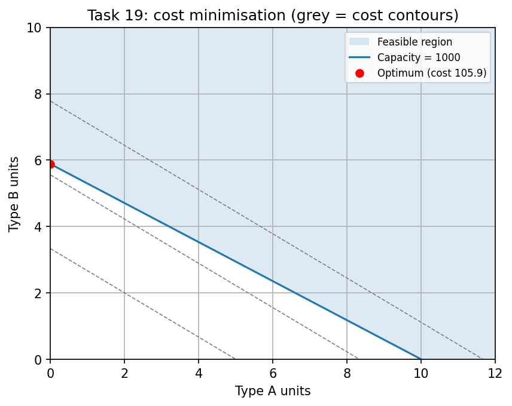

**New case – cheapest pig feed.** Mix 100 kg of maize bran (40 KES/kg, 9 % protein, 3.0 Mcal/kg) and soya meal (95 KES/kg, 44 % protein, 2.6 Mcal/kg) so that it has at least 18 kg protein and 285 Mcal. Solved with `linprog`: 74.29 kg maize and 25.71 kg soya at 5,414.29 KES. If soya rises to 130 KES the mix stays the same and the cost goes to 6,314.29. If the protein target is 20 kg the mix becomes 68.57/31.43 kg at 5,728.57 KES.

A first attempt used 290 Mcal for energy; the solver said infeasible. That makes sense: more soya raises protein but lowers energy, so the two requirements can't both be met.

---

## Task 20 – Random numbers and Monte Carlo

**Inputs and operation.** Server demand is normal with mean 850 and standard deviation 120; capacity is 1000. We simulate 100,000 scenarios and count how often demand exceeds capacity.

**Output.** Estimated overload probability 10.616 % (10,616 of 100,000). The exact value from the normal distribution is 10.565 %, so the simulation is off by only 0.05 percentage points. The running-estimate graph is noisy at the start and settles near the exact value as N grows.

**Changed input.** With N = 100 the estimate was 2 % (far off), 1,000 → 10.1 %, 10,000 → 10.49 %, 1,000,000 → 10.570 %. Error shrinks roughly with 1/√N. Repeating the N = 10,000 run with 200 seeds gave a standard deviation of 0.31 %, matching the theoretical 0.31 %. Capacity 1100 reduces the risk to about 1.9 %; a mean demand of 900 doubles it to about 20.2 %.

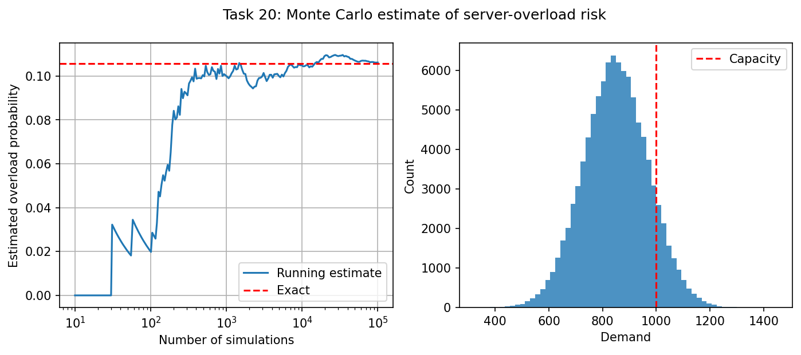

**New case – project deadline risk and a clinic queue.**

*Project:* three sequential tasks (design, build, test) with triangular durations. Mean 28.99 days; the 90th percentile is 34.09 days; probability of exceeding 30 days is 38.3 % and of exceeding 25 days is 85.0 %. So a 30-day promise is a coin flip with a bit extra.

*Clinic queue:* patients arrive every 10 min on average. If service takes 6 min the average wait is 8.9 min; at 8 min it's 31.0; at 9 min it's 76.9; at 9.5 min it's 155 min.

Interpretation: waiting time explodes as the service time approaches the arrival interval. A small slowdown in the doctor's speed can mean a huge increase in waiting.

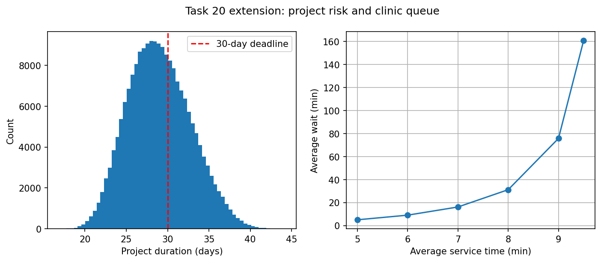
